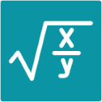



# Math Expression Evaluator in .NET

NuGet packages:

- MathEvaluator  
- MathEvaluator.FastExpressionCompiler  

MathEvaluator is a .NET library that allows you to evaluate and compile any mathematical expressions from a string dynamically.

## Features
- Supports different mathematical contexts, such as scientific, programming, and other custom contexts.
- Evaluates Boolean logic, as well as Double, Decimal, and Complex numbers.
- Supports `INumberBase<T>` types (.NET 7+), including `BigInteger`, `int`, `long`, `float`, `Half`, and other numeric types.
- Compiles a math expression string into executable code and produces a delegate that represents the math expression.
- Compiles math expressions with async functions into an async delegate that returns `ValueTask<TResult>` or `ValueTask<T, TResult>`.
- Provides variable support within math expressions (including expression-defined variables).
- Extensible with custom functions and operators.
- Fast and comprehensive. More than 6000 tests are passed, including complex math expressions (for example, -3^4sin(-π/2) or sin-3/cos1).
- Multi-targets .NET 8, .NET 9, and .NET 10 for optimal performance on each platform.
- .NET Standard 2.1 compatible in versions prior to [3.0.0](https://github.com/AntonovAnton//math.evaluation/releases/tag/3.0.0).

## Articles
[Evaluating Boolean logical expressions.](https://medium.com/@AntonAntonov88/evaluate-boolean-expression-from-string-in-c-net-af80e08453ea)

## Performance
This math expression evaluator is designed for exceptional performance by leveraging modern .NET features and best practices, which is why it targets .NET Standard 2.1 or higher.

**NOTE:** In version [3.0.0](https://github.com/AntonovAnton//math.evaluation/releases/tag/3.0.0) or higher, minimal .NET 7 is required. For version [3.6.0](https://github.com/AntonovAnton//math.evaluation/releases/tag/v3.6.0) or higher, minimal .NET 8.

This high-performance evaluator stands out due to its use of `ReadOnlySpan<char>`, and avoidance of regular expressions. These design choices collectively ensure minimal memory allocation, fast parsing, and efficient execution.

The evaluator uses recursive method calls to handle mathematical operations based on operator precedence and rules, an operator with highest precedence is evaluating first. This approach avoids the overhead associated with stack or queue data structures.

The evaluator uses a prefix tree, also known as a trie (pronounced "try"), for efficient searching of variables, operators, and functions by their keys (names) when providing a specific mathematical context or adding custom variables, operators, and functions is required.

### Benchmark Results

MathEvaluator is compared with other popular .NET math expression libraries on the expression:

    (a * b + c) / (a - b) * 2.5 - c / (b + 0.75) + 1000    with a = 5, b = 10, c = 60.5

It uses all four arithmetic operators, operator precedence, nested parentheses, decimal literals and variables, limited to the syntax that every compared library supports. Each library uses its fastest form for each scenario, and every library's result is verified before measuring.

#### Parse + evaluate a new expression every time

Every call parses a math expression string never seen before (the constant `1000` is replaced with a different number), sets the variables and evaluates it once. Caches of parsed expressions are disabled.

| Rank | Library | .NET 10.0 | .NET 8.0 | Allocated | Relative |
|-----:|---------|----------:|---------:|----------:|---------:|
| 1 | **MathEvaluator** ² | **684.5 ns** | **843.2 ns** | **896 B** | **1.00x** |
| 2 | NTDLS.ExpressionParser | 990.4 ns | 1,115.3 ns | 1,208 B | 1.45x |
| 3 | xFunc | 2,360.7 ns | 2,703.8 ns | 1,960 B | 3.45x |
| 4 | Mathos Parser ³ | 5,064.4 ns | 6,555.8 ns | 2,766 B | 7.40x |
| 4 | NCalc | 5,238.3 ns | 6,125.7 ns | 4,328 B | 7.65x |
| 5 | NoStringEvaluating | 18,021.0 ns | 26,125.8 ns | 3,152 B | 26.3x |
| 6 | CalcExpr.NET | 333,776.3 ns | 387,482.2 ns | 339,699 B | 488x |
| 7 | Jace ¹ | 1,373,822.3 ns | 221,379.0 ns | 27,836 B | 2,007x |
| 8 | Flee ¹ | 3,366,255.5 ns | 173,439.5 ns | 107,647 B | 4,918x |

#### Evaluate one expression many times

Each library parses (or compiles) the expression once, then only the evaluation is measured.

| Rank | Library | .NET 10.0 | .NET 8.0 | Allocated | Relative |
|-----:|---------|----------:|---------:|----------:|---------:|
| 1 | **MathEvaluator** (compiled) | **1.80 ns** | **1.79 ns** | **-** | **1.00x** |
| 1 | **MathEvaluator.FastExpressionCompiler** (compiled) | **1.80 ns** | **1.78 ns** | **-** | **1.00x** |
| 1 | NCalc.LambdaCompilation (compiled) | 1.81 ns | 1.79 ns | - | 1.00x |
| 2 | NTDLS.ExpressionParser | 59.65 ns | 69.09 ns | - | 33.2x |
| 3 | Flee ¹ | 67.68 ns | 72.36 ns | - | 37.6x |
| 4 | NoStringEvaluating | 143.35 ns | 192.86 ns | - | 79.7x |
| 5 | xFunc | 180.75 ns | 246.65 ns | 288 B | 100x |
| 6 | Jace ¹ | 194.16 ns | 226.15 ns | 624 B | 108x |
| 7 | CalcExpr.NET | 334.52 ns | 463.45 ns | 720 B | 186x |
| 8 | NCalc | 671.56 ns | 801.30 ns | 1,912 B | 373x |
| 9 | Mathos Parser ³ | 4,043.26 ns | 5,294.78 ns | 1,384 B | 2,247x |

A compiled delegate is a plain .NET method, so the compiling libraries perform the same once compiled; they differ in how long compiling takes.

#### Compile cost

Only libraries that compile expressions to delegates. **Compile** is the time to get a delegate; **Compile + first call** also evaluates it once, which includes JIT-compiling the generated code.

| Rank | Library | Compile .NET 10.0 | Compile .NET 8.0 | Compile + first call .NET 10.0 | Compile + first call .NET 8.0 | Allocated |
|-----:|---------|----------:|---------:|----------:|---------:|----------:|
| 1 | **MathEvaluator.FastExpressionCompiler** | **6.1 μs** | **6.6 μs** | **109.6 μs** | **87.9 μs** | **4.3 KB** |
| 2 | NCalc.LambdaCompilation | 10.2 μs | 12.1 μs | 118.0 μs | 90.7 μs | 4.7 KB |
| 3 | Flee ¹ | 76.1 μs | 80.6 μs | 3,367.9 μs | 169.6 μs | 105.0 KB |
| 4 | **MathEvaluator** | **119.0 μs** | **88.0 μs** | **111.5 μs** | **86.4 μs** | **8.4 KB** |
| 5 | Jace ¹ | 1,377.1 μs | 217.5 μs | 1,360.6 μs | 218.4 μs | 26.4 KB |

MathEvaluator.FastExpressionCompiler gets a delegate **~20x faster** than the built-in `LambdaExpression.Compile()`. Including the first call, the JIT compilation of the generated code takes most of the time, so the compiling libraries end up close.

*Rank and Relative are for .NET 10.0. Times are per call (Rank of the compile table is by Compile time on .NET 10.0).*

¹ Flee and Jace compile every expression to IL, which the JIT compiles before its first run, so every new expression is slow. Jace reuses compiled code for a repeated math expression string even with its cache disabled, which is why every call gets a new one. Both are much slower to compile a new expression on .NET 10.0 than on .NET 8.0.  
² For a single evaluation MathEvaluator uses its interpreter, which is much faster than compiling. Compile only when the same expression is evaluated many times.  
³ MathosParser 2.0.0 is published as a non-optimized (Debug) build.

*Measured with BenchmarkDotNet v0.15.8 on Windows 11, 11th Gen Intel Core i7-11800H 2.30GHz. Source: [LibraryComparisonBenchmarks.cs](https://github.com/AntonovAnton/math.evaluation/blob/main/MathEvaluation.Benchmarks/LibraryComparisonBenchmarks.cs). Full results are available in the [benchmarks](https://github.com/AntonovAnton/math.evaluation/tree/main/BenchmarkDotNet.Artifacts/results).*

## Compilation
Added in version [2.0.0](https://github.com/AntonovAnton/math.evaluation/releases/tag/2.0.0)

By using compilation, you can convert any mathematical expression string into a delegate, such as `Func<T, TResult>` or `Func<TResult>`, which significantly improves performance when evaluating the expression. 
However, since compilation takes additional time, and MathEvaluator already provides fast evaluation, it is recommended to compile the expression only if you plan to evaluate it repeatedly, particularly for 150 or more iterations. For detailed performance insights, refer to the [benchmarks](https://github.com/AntonovAnton/math.evaluation/tree/main/BenchmarkDotNet.Artifacts/results).

The compiled delegate can be executed with different parameters, allowing you to pass variables and functions as arguments. This feature is particularly useful for scenarios where the same expression needs to be evaluated with different variable values or functions.

In version [2.3.0](https://github.com/AntonovAnton/math.evaluation/releases/tag/2.3.0) you can also use a `IDictionary<string, TResult>` or `IDictionary<string, object>` as a parameters input type. This allows you to pass variables and their values in a more flexible way, especially when working with dynamic inputs or when the structure of input parameters is not known in advance.

In version [2.6.0](https://github.com/AntonovAnton/math.evaluation/releases/tag/2.6.0) support for `ExpandoObject` as a parameters input type has been added. This allows for dynamic binding of variables in a more flexible manner, no predefined class structure required.

In version [2.3.1](https://github.com/AntonovAnton/math.evaluation/releases/tag/2.3.1) added `IExpressionCompiler` interface, which allows you to inject your own compiler. This is useful if you want to use a different compiler or if you want to customize the compilation process in some way.

**MathEvaluator.FastExpressionCompiler** is an extension of the MathEvaluator library that uses the [FastExpressionCompiler](https://github.com/dadhi/FastExpressionCompiler) to provide performance improvements of up to 10-40x compared to the built-in .NET `LambdaExpression.Compile()` method.  

This library includes all features of the MathEvaluator library but adds a dependency on FastExpressionCompiler. For more details, refer to the [documentation](https://github.com/AntonovAnton/math.evaluation/tree/main/MathEvaluation.FastExpressionCompiler).

## How to use
Examples of using string extentions:

    "22888.32 * 30 / 323.34 / .5 - -1 / (2 + 22888.32) * 4 - 6".Evaluate();

    "22888.32 * 30 / 323.34 / .5 - -1 / (2 + 22888.32) * 4 - 6".Evaluate<decimal>();

    "$22,888.32 * 30 / 323.34 / .5 - - 1 / (2 + $22,888.32) * 4 - 6".Evaluate(null, new CultureInfo("en-US"));

    "22’888.32 CHF * 30 / 323.34 / .5 - - 1 / (2 + 22’888.32 CHF) * 4 - 6".Evaluate<decimal>(null, new CultureInfo("de-CH"));

    "ln(1/-0.5 + √(1/(0.5^2) + 1))".Evaluate(new ScientificMathContext());
    
    "P * (1 + r/n)^d".Evaluate<decimal>(new { P = 10000, r = 0.05, n = 365, d = 31 }, new DecimalScientificMathContext());
    
    "2 ** 100".Evaluate<BigInteger>(new ProgrammingMathContext());
    
    "4 ^ 3".Evaluate(new ScientificMathContext());

    "4 <> 4 OR 5.4 = 5.4 AND NOT 0 < 1 XOR 1.0 - 1.95 * 2 >= -12.9 + 0.1 / 0.01".EvaluateBoolean(new ProgrammingMathContext());

    "¬⊥∧⊤∨¬⊤⇒¬⊤".EvaluateBoolean(new ScientificMathContext());
    
    "sin(2 + 3i) * arctan(4i)/(1 - 6i)".Evaluate<Complex>(new ComplexScientificMathContext());

    "0b1010 * 0o12 / 0xA + 10".Evaluate(); // Mixed numeric systems: 10 * 10 / 10 + 10 = 20

**NOTE:** Starting with version [3.7.0](https://github.com/AntonovAnton/math.evaluation/releases/tag/v3.7.0), `EvaluateDecimal` and `EvaluateComplex` are obsolete. Use the generic `Evaluate<decimal>` and `Evaluate<Complex>` methods instead.

Examples of using an instance of the MathExpression class:

    new MathExpression("22’888.32 CHF * 30 / 323.34 / .5 - - 1 / (2 + 22’888.32 CHF) * 4 - 6", null, new CultureInfo("de-CH")).Evaluate<decimal>();
    
    new MathExpression("sin(2 + 3i) * arctan(4i)/(1 - 6i)", new ComplexScientificMathContext()).Evaluate<Complex>();

Examples of passing custom variables and functions as parameters (Support expression-defined variables added in version [2.4.0](https://github.com/AntonovAnton/math.evaluation/releases/tag/2.4.0)):

    var x1 = 0.5;
    var x2 = -0.5;
    var y = "x1 * x2"; // expression-defined variable
    var sqrt = Math.Sqrt;
    Func<double, double> ln = Math.Log;

    var value1 = "ln(1/-x1 + sqrt(1/(x2*x2) + 1)) + y"
        .Evaluate(new { x1, x2, y, sqrt, ln });

    var parameters = new MathParameters();
    parameters.BindVariable(x1);
    parameters.BindVariable(x2);
    parameters.BindExpressionVariable(y); // expression-defined variable
    parameters.BindFunction(sqrt);
    parameters.BindFunction<double>(d => Math.Log(d), "ln");

    var value2 = "ln(1/-x1 + sqrt(1/(x2*x2) + 1)) + y"
        .Evaluate(parameters);

Example of using custom context:

    var context = new MathContext();
    context.BindFunction<double>(Math.Sqrt);
    context.BindFunction<double>(d => Math.Log(d), "ln");
    context.BindExpressionVariable("x1 * x2", "y"); // expression-defined variable

    var value = "ln(1/-x1 + Math.Sqrt(1/(x2*x2) + 1)) + y"
        .Evaluate(new { x1 = 0.5, x2 = -0.5 }, context);
    
Example of using composite context (Added in version [3.7.0](https://github.com/AntonovAnton/math.evaluation/releases/tag/v3.7.0)):

    var context = new CompositeMathContext(
        new ScientificMathContext(), new DotNetMathContext());

    var value = "sin(π/2) + Math.Log(100.0)"
        .Evaluate(context);

Example of evaluating C# expression:

    var value = "-2 * Math.Log(1/0.5f + Math.Sqrt(1/Math.Pow(0.5d, 2) + 1L))"
        .Evaluate(new DotNetMathContext());

Example of compilation with an object as a parameter:

    var fn = "ln(1/x1 + √(1/(x2*x2) + 1))"
        .Compile(new { x1 = 0.0, x2 = 0.0 }, new ScientificMathContext());
        
    var value = fn(new { x1 = -0.5, x2 = 0.5 });

Example of compilation with a Dictionary as a parameter (Added in version [2.3.0](https://github.com/AntonovAnton/math.evaluation/releases/tag/2.3.0)):

    var dict = new Dictionary<string, double>();
    dict.Add("x1", 3.0);
    dict.Add("x2", 2.0);

    var fn = "x1 + Math.Sin(x2) * 0.5"
        .Compile(dict, new DotNetStandardMathContext());

    var value = fn(dict);

    dict.Clear();
    dict.Add("x1", 3.0);
    dict.Add("x3", 2.0);
    dict.Add("x4", 4.0);

    fn = "x1 + Math.Sin(x3) * Math.Cos(x4)"
        .Compile(dict, new DotNetStandardMathContext());

**MathContext** class defines the mathematical "language" available in expressions - what operators, functions, and constants can be used. It's reusable across multiple evaluations and determines syntax rules (e.g., whether to use `^` or `**` for exponentiation, which functions like `sin`, `cos`, `sqrt` are available).

**CompositeMathContext** combines several math contexts into one. You can also bind entities directly to the composite context.
When the same input matches entities from several contexts, the entity with the longest key wins (e.g. `ab` is preferred over `a`). On a tie, entities bound directly to the composite context win, then the contexts in the order they were added.

**MathParameters** class provides the actual values and custom implementations for a specific evaluation. It supplies variable values and function delegates that are used when evaluating a particular expression.

## Async functions
Added in version [3.8.0](https://github.com/AntonovAnton/math.evaluation/releases/tag/v3.8.0)

Async functions that return `ValueTask<T>` and take a `CancellationToken` as the last parameter can be bound with `BindAsyncFunction` and used in a math expression compiled by the `CompileAsyncFunc` method:

    var context = new MathContext();
    context.BindAsyncFunction<double>(async (id, cancellationToken) => await priceService.GetPriceAsync(id, cancellationToken), "price");
    context.BindAsyncFunction<double>((amount, rate, _) => ValueTask.FromResult(amount * rate), "tax");

    var fn = new MathExpression("price(id) * qty + tax(price(id) * qty, 0.2)", context)
        .CompileAsyncFunc(new { id = 0, qty = 0d });

    var total = await fn(new { id = 42, qty = 3d }, cancellationToken);

Expression-defined variables can use async functions too:

    context.BindExpressionVariable("price(id) * qty", "subtotal"); // expression-defined variable

    var fn = new MathExpression("subtotal + subtotal * 0.2", context)
        .CompileAsyncFunc(new { id = 0, qty = 0d });

    var total = await fn(new { id = 42, qty = 3d }, cancellationToken);

Async calls are awaited one after another in the order of the math expression string, and each call is invoked, even if the same call is repeated. An expression-defined variable is calculated once, after its async functions are awaited. Synchronous methods such as `Evaluate` and `Compile` throw a `MathExpressionException` if the math expression contains an async function.

## AOT (Ahead-of-Time) compilation support
Added in version [3.6.0](https://github.com/AntonovAnton/math.evaluation/releases/tag/v3.6.0)

MathEvaluator supports Ahead-of-Time (AOT). However, AOT support is limited to evaluation using `Dictionary<string, TResult>`, `Dictionary<string, object>`, and `MathParameters` as a parameters input type.

**NOTE:** When using AOT, ensure you use either:
- `Dictionary<string, TResult>` to pass variables and their values
- `Dictionary<string, object>` or `MathParameters` to pass variables and functions as parameters.

Other parameters passing methods (custom classes, `ExpandoObject`, etc.) are not supported in AOT scenarios.

## How to debug or log

Added in version [2.1.0](https://github.com/AntonovAnton/math.evaluation/releases/tag/2.1.0)

By using the `Evaluating` event, you can debug or log the steps of a math expression's evaluation. This event is triggered at each step during the evaluation process. The following code demonstrates how to use to this event:

    using var expression = new MathExpression("-3^4sin(-PI/2)", new ScientificMathContext());

    expression.Evaluating += (object? sender, EvaluatingEventArgs args) =>
    {
        Console.WriteLine("{0}: {1} = {2};{3}",
            args.Step,
            args.MathString[args.Start..(args.End + 1)],
            args.Value,
            args.IsCompleted ? " //completed" : string.Empty);
    };
    
    var value = expression.Evaluate();

Output:

    1: 3^4 = 81;
    2: PI = 3.141592653589793;
    3: PI/2 = 1.5707963267948966;
    4: -PI/2 = -1.5707963267948966;
    5: sin(-PI/2) = -1;
    6: 3^4sin(-PI/2) = -81;
    7: -3^4sin(-PI/2) = 81; //completed

You can also ovverride the `OnEvaluating` method in a derived class of `MathExpression` to handle the Evaluating event. Delegates are more expensive than a virtual method call. So by overriding the method means a subclass can subscribe to an event with less runtime overhead than using an event-handler.

***NOTE**: To prevent memory leaks, it's important to unsubscribe from the event after subscribing to it. The Evaluating event is cleaned up in the Dispose method, so I recommend using the **using** statement to ensure proper disposal and efficient resource management.*

## Complex numbers

Added in version [2.2.0](https://github.com/AntonovAnton/math.evaluation/releases/tag/2.2.0)

Complex numbers are written in the form **a ± bi**, where **a** is the real part and **bi** is the imaginary part. 
In mathematical expressions involving complex numbers, it's advisable to use parentheses () to ensure clarity and obtain the expected result.

## Numeric systems

Added in version [2.4.3](https://github.com/AntonovAnton/math.evaluation/releases/tag/2.4.3)

MathEvaluator now supports binary, octal, and hexadecimal numeric systems in addition to the default decimal system.

**Binary numbers** are prefixed with `0b` or `0B` and contain only digits 0 and 1:

    "0b1010 + 0B1111".Evaluate(); // Result: 25 (10 + 15 in decimal)

**Octal numbers** are prefixed with `0o` or `0O` and contain digits 0-7:

    "0o17 + 0O25".Evaluate(); // Result: 36 (15 + 21 in decimal)

**Hexadecimal numbers** are prefixed with `0x` or `0X` and contain digits 0-9 and letters A-F (case insensitive):

    "0xFF + 0X10".Evaluate(); // Result: 271 (255 + 16 in decimal)

These numeric systems work seamlessly with all mathematical operations and contexts, and the results are always returned in decimal format.

## INumberBase<T> 

Added in version [2.6.0](https://github.com/AntonovAnton/math.evaluation/releases/tag/2.6.0)

For .NET 7 and higher, MathEvaluator supports any numeric type that implements `INumberBase<T>`, providing type-safe mathematical expression evaluation across different numeric representations.

### BigInteger Examples

**Evaluation:**

    "2 ** 100".Evaluate<BigInteger>(new ProgrammingMathContext());
    // Result: 1267650600228229401496703205376

**Compilation:**

    var expression = new MathExpression("2 ** a", new ProgrammingMathContext());

    dynamic parameters = new ExpandoObject();
    parameters.a = 0;

    var fn = expression.Compile<ExpandoObject, BigInteger>(parameters);
    
    parameters.a = 100;
    var result = fn(parameters);
    // Result: 1267650600228229401496703205376

## Supported math functions, operators, and constants

#### When no mathematical context is specified:
|          | Notation | Precedence |
|--------- |--------- | --------- |
| Addition | + | 0 |
| Subtraction, Negativity | - | 0 |
| Multiplication  | * | 100 |
| Division  | / | 100 |
| Parentheses  | ( ) | 200 |
| Currency symbol  | depends on culture info | |

#### Programming Math Context (using ProgrammingMathContext class):
|          | Notation | Precedence |
|--------- |--------- |--------- |
| Addition | + | 0 |
| Subtraction, Negativity | - | 0 |
| Multiplication  | * | 100 |
| Division  | / | 100 |
| Parentheses  | ( ) | 200 |
| Currency symbol  | depends on culture info | |
| Exponentiation | ** | 400 |
| Modulus | % | 100 |
| Floor Division  | // | 100 |
| Logical constants  | true, false, True, False, TRUE, FALSE | 300 |
| Equality  | = | -100 |
| Inequality  | \<> | -100 |
| Less than  | \< | -100 |
| Greater than  | > | -100 |
| Less than or equal  | \<= | -100 |
| Greater than or equal  | >= | -100 |
| Logical negation  | not, Not, NOT | -200 |
| Logical AND  | and, And, AND | -300 |
| Logical exclusive OR  | xor, Xor, XOR | -400 |
| Logical OR  | or, Or, OR | -500 |
| Conditional operation: `IIF(condition, valueIfTrue, valueIfFalse)`, where the `valueIfTrue` and `valueIfFalse` args are optional | iif, Iif, IIF | 200 |

#### Scientific Math Context (using ScientificMathContext class):

|          | Notation | Precedence |
|--------- |--------- | --------- |
| Addition | + | 0 |
| Subtraction, Negativity | - | 0 |
| Multiplication  | *, ×, or · | 100 |
| Division  | / or ÷ | 100 |
| Parentheses | ( ) | 200 |
| Currency symbol  | depends on culture info | |
| Exponentiation | ^, pow, Pow, POW | 400 for ^, 200 |
| Modulus | mod, Mod, MOD, modulo, Modulo, or MODULO | 100 |
| Floor Division  | // | 100 |
| Absolute  | \| \|, abs, Abs, ABS | 200 |
| Positive part | pos, Pos, POS | 200 |
| Ceiling | ⌈ ⌉, ceil, Ceil, CEIL | 200 |
| Floor | ⌊ ⌋, floor, Floor, FLOOR | 200 |
| Square root | √, sqrt, Sqrt, SQRT | 200 |
| Cube root | ∛, cbrt, Cbrt, CBRT | 200 |
| Fourth root | ∜ | 200 |
| Natural logarithmic base | e | 300 |
| Natural logarithm | ln, Ln, LN | 200 |
| Common logarithm (base 10) | log, Log, LOG | 200 |
| Exponential function | exp, Exp, EXP | 200 |
| Factorial | ! | 500 |
| Infinity | ∞ | 300 |
| Logical constants  | true, false, True, False, TRUE, FALSE, T, F, ⊤, ⊥ | 300 |
| Equality  | = | -100 |
| Inequality  | ≠ | -100 |
| Less than  | \< | -100 |
| Greater than  | > | -100 |
| Less than or equal  | ≤, ⪯ | -100 |
| Greater than or equal  | ≥, ⪰ | -100 |
| Logical negation  | ¬, not, Not, NOT | 500 for ¬, -200 |
| Logical AND  | ∧, and, And, AND | -300 |
| Logical exclusive OR  | ⊕, xor, Xor, XOR | -400 |
| Logical OR  | ∨, or, Or, OR | -500 |
| Logical implication  | →, ⇒, ←, ⟸ | -800 |
| Logical biconditional equivalence  | ↔, ⇔ | -900 |
| Logical biconditional inequivalence  | ↮, ⇎ | -900 |
| Logical equivalence  | ≡ | -1000 |
| Logical inequivalence  | ≢ | -1000 |
| Degrees to radians | °, rad, Rad, RAD | 500 for °, 200 |
| Radians to degrees | deg, Deg, DEG | 200 |
| Pi constant | π, pi, Pi, PI | 300 |
| Tau constant | τ | 300 |
| Sine | sin, Sin, SIN | 200 |
| Cosine | cos, Cos, COS | 200 |
| Tangent | tan, Tan, TAN | 200 |
| Secant | sec, Sec, SEC | 200 |
| Cosecant | csc, Csc, CSC | 200 |
| Cotangent | cot, Cot, COT | 200 |
| Hyperbolic sine | sinh, Sinh, SINH | 200 |
| Hyperbolic cosine | cosh, Cosh, COSH | 200 |
| Hyperbolic tangent | tanh, Tanh, TANH | 200 |
| Hyperbolic secant | sech, Sech, SECH | 200 |
| Hyperbolic cosecant | csch, Csch, CSCH | 200 |
| Hyperbolic cotangent | coth, Coth, COTH | 200 |
| Inverse sine | asin, Asin, ASIN, arcsin, Arcsin, ARCSIN, sin\^-1, Sin\^-1, SIN\^-1 | 200 |
| Inverse cosine | acos, Acos, ACOS, arccos, Arccos, ARCCOS, cos\^-1, Cos\^-1, COS\^-1 | 200 |
| Inverse tangent | atan, Atan, ATAN, arctan, Arctan, ARCTAN, tan\^-1, Tan\^-1, TAN\^-1 | 200 |
| Inverse secant | asec, Asec, ASEC, arcsec, Arcsec, ARCSEC, sec\^-1, Sec\^-1, SEC\^-1 | 200 |
| Inverse cosecant | acsc, Acsc, ACSC, arccsc, Arccsc, ARCCSC, csc\^-1, Csc\^-1, CSC\^-1 | 200 |
| Inverse cotangent | acot, Acot, ACOT, arccot, Arccot, ARCCOT, cot\^-1, Cot\^-1, COT\^-1 | 200 |
| Inverse Hyperbolic sine | asinh, Asinh, ASINH, arsinh, Arsinh, ARSINH, sinh\^-1, Sinh\^-1, SINH\^-1 | 200 |
| Inverse Hyperbolic cosine | acosh, Acosh, ACOSH, arcosh, Arcosh, ARCOSH, cosh\^-1, Cosh\^-1, COSH\^-1 | 200 |
| Inverse Hyperbolic tangent | atanh, Atanh, ATANH, artanh, Artanh, ARTANH, tanh\^-1, Tanh\^-1, TANH\^-1 | 200 |
| Inverse Hyperbolic secant | asech, Asech, ASECH, arsech, Arsech, ARSECH, sech\^-1, Sech\^-1, SECH\^-1 | 200 |
| Inverse Hyperbolic cosecant | acsch, Acsch, ACSCH, arcsch, Arcsch, ARCSCH, csch\^-1, Csch\^-1, CSCH\^-1 | 200 |
| Inverse Hyperbolic cotangent | acoth, Acoth, ACOTH, arcoth, Arcoth, ARCOTH, coth\^-1, Coth\^-1, COTH\^-1 | 200 |

#### How to evaluate a C# math expression string
**DotNetStandardMathContext** is the .NET Standard 2.1 programming math context supports all constants and functions provided by the `System.Math` and `System.Numerics.Complex`, along with equality, comparison, and logical boolean operators.

**DotNetMathContext** (.NET 7+ only): Enhanced version that includes all features of DotNetStandardMathContext plus:
- Latest .NET 7+ Math functions: `Math.Log2`, `Math.ILogB`, `Math.ScaleB`, `Math.BitIncrement`, `Math.BitDecrement`, `Math.CopySign`, `Math.FusedMultiplyAdd`, etc.
- Full `BigInteger` support: `BigInteger.Pow`, `BigInteger.ModPow`, `BigInteger.GreatestCommonDivisor`, and all arithmetic operations
- Modern numeric types: `Half`, `Int128`, `UInt128`, `nint`, `nuint`
- Enhanced constants: `Math.Tau`, type-specific min/max values for all numeric types

**Example using DotNetMathContext:**

    // BigInteger cryptography example (.NET 7+)
    var context = new DotNetMathContext();
    
    var p = "2305843009213693951";
    var q = "2305843009213693967";

    var encrypted = "BigInteger.ModPow(message, e, p * q)"
        .Evaluate<BigInteger>(new { message = 123456789, e = 65537, p, q }, context);

    // Using new Math functions
    var result = "Math.Log2(1024) + Math.Tau / 2".Evaluate(null, context);
    // Result: 10 + π

## Error Handling

When an invalid mathematical expression is provided, the library throws a `MathExpressionException` with a descriptive error message that includes the position of the error. This helps you quickly identify and fix issues in your expressions.

Example:

    try
    {
        "12 + abs()".Evaluate(context: new ScientificMathContext());
    }
    catch (MathExpressionException ex)
    {
        Console.WriteLine(ex.Message);
        // Output: Error of evaluating the expression. The operand is not recognizable. Invalid token at position 9.
    }

### Nesting depth

The parser is recursive, so the nesting depth of a math expression string is limited by the call stack size of the
thread that evaluates or compiles it. There is no hardcoded limit: the parser probes the remaining call stack as it
goes, so a thread with a bigger stack evaluates a deeper expression. When the call stack is about to run out, the
parsing stops and throws a `MathExpressionException` instead of terminating the process with a `StackOverflowException`,
which .NET cannot catch. The depth that was reached is reported by `MathExpressionException.NestingDepth` and by
`ex.Data["nestingDepth"]`.

Example:

    try
    {
        new string('(', 1000000).Evaluate();
    }
    catch (MathExpressionException ex)
    {
        Console.WriteLine(ex.NestingDepth);
        // Output: the nesting depth at which the parsing was stopped, for example 784.
    }

Note that a long chain of operators, such as `1 + 1 + 1 + ...`, is not a nesting, so parsing it doesn't consume the
call stack and its length is not limited by the guard.

## Contributing
Contributions are welcome! Please fork the repository and submit pull requests for any enhancements or bug fixes.
If you enjoy my work and find it valuable, please consider becoming my [sponsor on GitHub](https://github.com/sponsors/AntonovAnton). Your support will enable me to share more open-source code. Together, we can make a positive impact in the developer community!

Looking to localize your project? Check out [l10n.dev](https://l10n.dev), an AI-powered localization service. [Translate JSON](https://l10n.dev/ws/translate-json) files while preserving format, keys, and placeholders. Supports 165 languages with an easy-to-use API and UI. Get started for free!

## License
This project is licensed under the Apache License, Version 2.0 - see the [LICENSE](https://github.com/AntonovAnton/math.evaluation?tab=Apache-2.0-1-ov-file) file for details.

## Contact
If you have any questions or suggestions, feel free to open an issue or contact me directly.

